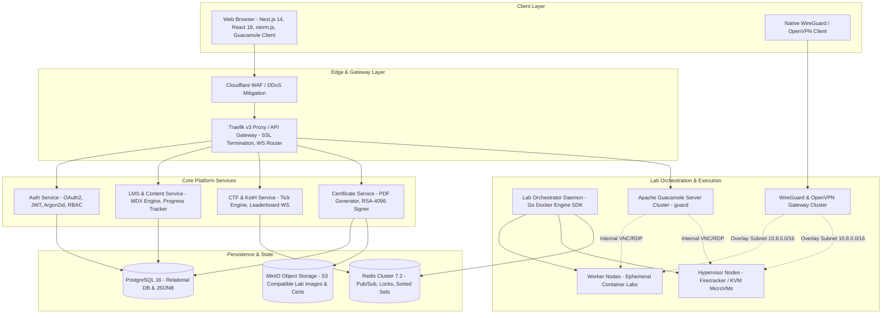

> **Thiết kế UI/UX hiện hành (2026-10-13):** [Modern Minimal v3](DESIGN.md), [wireframe](docs/07-wireframes/modern-minimal/README.md) và [gói prompt Stitch](docs/07-wireframes/modern-minimal/STITCH.md) là nguồn thiết kế. Web desktop là ưu tiên. Một số route đã dùng style mới; [ma trận hiện trạng](docs/07-wireframes/modern-minimal/IMPLEMENTATION-STATUS.md) phân biệt phần đã triển khai và ý tưởng. Các đoạn Neo-Brutalism/Tactical HUD còn lại chỉ là lịch sử dự án.

# 🛡️ CyberForce (CyberForge)

> **Next-Generation Cloud Cyber Range, Hands-on Security Training & Verifiable Digital Certification Platform**  
> *Nền tảng đào tạo an ninh mạng thực chiến, đấu trường đối kháng thời gian thực và khảo thí cấp chứng chỉ số thực hành thế hệ mới.*

---

### 🎓 THÔNG TIN ĐỒ ÁN & TÁC GIẢ
* **Sinh viên thực hiện:** **Phạm Như Quốc Bảo**
* **Mã sinh viên:** **21IT531**
* **Học phần:** **Đồ án môn học Chuyên đề 4**
* **Đề tài:** Nghiên cứu, thiết kế và xây dựng nền tảng Cyber Range thực hành an ninh mạng đám mây (*Cloud-native Cyber Range Platform*)

---

## 📌 Mục lục (Table of Contents)

1. [Giới thiệu Dự án (Introduction & Vision)](#-giới-thiệu-dự-án-introduction--vision)
2. [Vấn đề Thực tế & Giải pháp Đột phá (Problems & Solutions)](#-vấn-đề-thực-tế--giải-pháp-đột-phá)
3. [Các Phân hệ Tính năng Cốt lõi (Core Epics)](#-các-phân-hệ-tính-năng-cốt-lõi-core-epics)
4. [Kiến trúc Kỹ thuật & Công nghệ (Architecture & Tech Stack)](#-kiến-trúc-kỹ-thuật--công-nghệ-architecture--tech-stack)
5. [Cơ chế Bảo mật & Cách ly Mạng (Security & Anti-Abuse)](#-cơ-chế-bảo-mật--cách-ly-mạng-security--anti-abuse)
6. [Cấu trúc Thư mục Dự án (Project Structure)](#-cấu-trúc-thư-mục-dự-án-project-structure)
7. [Tiến độ Triển khai Dự án (Implementation Progress & Milestones)](#-tiến-độ-triển-khai-dự-án-implementation-progress--milestones)
8. [Hướng dẫn Cài đặt & Chạy Cục bộ (Getting Started)](#-hướng-dẫn-cài-đặt--chạy-cục-bộ-getting-started)
9. [Hệ thống Tài liệu Kỹ thuật (Documentation Hub)](#-hệ-thống-tài-liệu-kỹ-thuật-documentation-hub)
10. [Quy chuẩn Đóng góp & Phát triển GitFlow (Contributing & Git Guidelines)](#-quy-chuẩn-đóng-góp--phát-triển-gitflow-contributing--git-guidelines)
11. [Giấy phép (License)](#-giấy-phép-license)

---

## 🌐 Giới thiệu Dự án (Introduction & Vision)

**CyberForce (CyberForge)** là một nền tảng **Cyber Range trên nền tảng đám mây (Cloud-native Cyber Range)** toàn diện, được thiết kế nhằm xóa bỏ hoàn toàn rào cản kỹ thuật tiếp cận (*Zero-Friction*) cho người học và chuyên gia an ninh mạng.

Thay vì phải mất từ 3 đến 6 giờ để cài đặt máy ảo, cấu hình card mạng NAT phức tạp trên máy tính cá nhân, CyberForce cho phép học viên khởi chạy toàn bộ môi trường tấn công (**Kali Linux AttackBox**) và các máy chủ mục tiêu dễ bị tổn thương chỉ bằng **1-Click** trực tiếp trên tab trình duyệt web trong chưa đầy **3 giây**.

```
                           ┌─────────────────────────────────────────────────────────┐
                           │                   CYBERFORCE PILLARS                    │
                           └─────────────────────────────────────────────────────────┘
                                     │                      │                      │
                         ┌───────────▼──────────┐ ┌─────────▼──────────┐ ┌─────────▼──────────┐
                         │  ZERO-SETUP PRACTICE │ │  REAL-TIME ARENA   │ │ VERIFIABLE CERTS   │
                         │ • In-browser Kali    │ │ • King of the Hill │ │ • 100% Practical   │
                         │ • 1-Click Container  │ │ • Dynamic CTF      │ │ • RSA-4096 Sign    │
                         │ • Dual WireGuard VPN │ │ • Live Leaderboard │ │ • Public QR Verify │
                         └──────────────────────┘ └────────────────────┘ └────────────────────┘
```

### 🎯 Tầm nhìn & Sứ mệnh
* **Zero-Friction Access:** Dân chủ hóa giáo dục an ninh mạng. Bất kỳ ai sở hữu một trình duyệt web tiêu chuẩn đều có thể thực hành các kỹ thuật phòng thủ và tấn công mạng mà không cần máy tính cấu hình cao.
* **Grounded Practical Mastery:** Học đến đâu thực hành gõ lệnh đến đó thông qua mô hình phòng học tương tác chia 3 cột (Lý thuyết MDX - Nhiệm vụ câu hỏi - Terminal thực thi).
* **Cryptographic Integrity:** Đánh giá năng lực thực chất bằng kỳ thi Capstone thực hành 12h-24h trong mạng cô lập, cấp chứng chỉ số có chữ ký mật mã RSA-4096 và mã QR tra cứu công khai, chống gian lận tuyệt đối.

---

## 💡 Vấn đề Thực tế & Giải pháp Đột phá

| Vấn đề Hiện tại (Industry Pain Points) | Tác động Tiêu cực | Giải pháp Đột phá của CyberForce |
| :--- | :--- | :--- |
| **Rào cản cài đặt môi trường (Setup Friction)** | Người mới mất hàng giờ cài VMware/VirtualBox, cấu hình ISO Kali $\rightarrow$ 45% bỏ cuộc ngay tuần đầu. | **Cloud Sandbox 1-Click:** Khởi chạy Kali Linux & máy lab trực tiếp trên trình duyệt qua WebSockets/Guacamole trong $< 3$ giây. |
| **Học thụ động & Thiếu phản hồi** | Xem video lý thuyết suông, thiếu phản hồi tức thì và không có bài tập kiểm chứng thực tế. | **Task-Based Interactive Rooms:** Giáo trình chia nhỏ theo nhiệm vụ, tự động chấm cờ (Flags) và gợi ý từng bước (Tiered Hints). |
| **Nạn gian lận & Chia sẻ cờ (Share Flag)** | Các giải CTF và bài tập thường bị chia sẻ đáp án tĩnh lên mạng/Discord, mất tính công bằng. | **Dynamic Flag Engine:** Sinh cờ động ngẫu nhiên theo từng phiên dựa trên thuật toán HMAC-SHA256 bọc Salt cá nhân. |
| **Thiếu môi trường đối kháng thực tế** | Chỉ giải bài tập tĩnh cá nhân, thiếu kỹ năng phản xạ chiến đấu thực chiến và phòng thủ chủ động. | **King of the Hill (KotH):** Đấu trường đối kháng 45 phút, 10 người cùng khai thác, chiếm quyền root và patch lỗ hổng bảo vệ mục tiêu. |
| **Chứng chỉ trắc nghiệm thiếu giá trị** | Chứng chỉ câu hỏi lý thuyết dễ học tủ, nhà tuyển dụng không đo lường được năng lực thực tế. | **Practical Capstone Exams:** Bài thi thực hành 12h-24h trên mạng cô lập đa mục tiêu + Cổng tra cứu minh bạch `verify.cyberforce.io`. |

---

## 🚀 Các Phân hệ Tính năng Cốt lõi (Core Epics)

Hệ thống CyberForce được thiết kế xoay quanh **8 Epics chức năng hoàn chỉnh**:

```
┌────────────────────────────────────────────────────────────────────────────────────────────────────────────────────────┐
│                                             CYBERFORCE CORE CAPABILITIES                                               │
├────────────────────────────────┬───────────────────────────────┬───────────────────────────────────────────────────────┤
│ 1. Identity, Profiles & RBAC   │ 2. Learning Paths & Rooms     │ 3. Ephemeral Cloud Sandbox & AttackBox                │
│ • OAuth2 (GitHub/Google/GitLab)│ • Modular Curriculums         │ • 1-Click Docker Lab Spawner (<3s)                    │
│ • Granular RBAC (4 Vai trò)    │ • Tri-Pane Split Workspace    │ • In-browser Kali Linux (Guacamole RDP/VNC)           │
│ • Radar 8 Trục Kỹ năng         │ • Dynamic Tiered Hints        │ • Embedded xterm.js Web Terminal                      │
├────────────────────────────────┼───────────────────────────────┼───────────────────────────────────────────────────────┤
│ 4. Secure Dual-Stack VPN       │ 5. CTF Battles & KotH Arena   │ 6. Practical Capstone Exams & Certs                   │
│ • WireGuard Siêu tốc (UDP 51820│ • Đấu trường đối kháng KotH   │ • Kỳ thi khảo thí thực hành 12h-24h                   │
│ • OpenVPN TCP/443 dự phòng     │ • 60s Redis Tick Engine       │ • Chứng chỉ số ký RSA-4096                            │
│ • Live Health Check 1-Click    │ • Jeopardy Dynamic Decay CTF  │ • Cổng tra cứu công khai verify.cyberforce.io         │
├────────────────────────────────┴───────────────────────────────┴───────────────────────────────────────────────────────┤
│ 7. Gamification, Daily Streaks & Skill Radar                   │ 8. Lab Creator Studio & Enterprise B2B Analytics      │
│ • Chuỗi ngày Streak theo Local Timezone                        │ • Xưởng soạn thảo bài giảng MDX Live Preview          │
│ • Multiplier thưởng 1.2x & 1.5x EXP                            │ • Cơ chế kiểm thử bắt buộc Sandbox Dry-Run            │
│ • Thang 6 Cấp bậc & Cam kết Bảo toàn Hạng (Rank Invariant)     │ • Ma trận Lỗ hổng Kỹ năng (Skill Gap Heatmap) cho B2B │
└────────────────────────────────────────────────────────────────┴───────────────────────────────────────────────────────┘
```

1. **Epic 1: Quản lý Định danh, Hồ sơ Năng lực & Phân quyền Đa tầng (Identity & RBAC)**
   - Xác thực đa phương thức: OAuth2 (GitHub, Google, GitLab) và Email/Mật khẩu mã hóa Argon2id.
   - Hệ thống phân quyền chặt chẽ: `Student`, `Creator`, `Admin`, và `Enterprise Manager`.
   - Hồ sơ năng lực cá nhân với **Biểu đồ Radar 8 trục** chuyên môn (Web, Network, Binary, Crypto, DFIR, Windows/AD, Blue Team, Cloud/DevSecOps).

2. **Epic 2: Lộ trình Đào tạo Chuẩn hóa & Phòng học Tương tác (Curriculum & Rooms)**
   - Các lộ trình chuyên sâu: *Pre-Security, Certified Offensive Web Associate, SOC Analyst Tier 1, Active Directory Exploitation*.
   - Giao diện phòng học 3 cột độc quyền (*Tri-Pane Workspace*): Cột trái (Lý thuyết MDX) - Cột giữa (Nhiệm vụ & Nộp cờ) - Cột phải (Terminal nhúng).
   - Cơ chế lưu nháp ngoại tuyến an toàn (*Offline-First Auto-Draft*).

3. **Epic 3: Môi trường Thực hành Đám mây Không Cài Đặt (Ephemeral Cloud Sandbox)**
   - Điều phối vùng chứa Docker chỉ trong **< 3 giây** cho các bài lab cơ bản.
   - Ảo hóa sâu **MicroVM (Firecracker / KVM)** cho các bài lab can thiệp Kernel, Active Directory và Windows Server.
   - Tích hợp máy trạm **Kali Linux AttackBox** chạy trực tiếp trên canvas HTML5 thông qua cụm máy chủ Apache Guacamole.

4. **Epic 4: Cổng Kết nối Mạng Riêng Ảo Kép (Dual-Stack VPN Gateway)**
   - Hỗ trợ **WireGuard** (giao thức mặc định, băng thông cao, độ trễ cực thấp qua cổng UDP 51820).
   - Cung cấp cấu hình **OpenVPN** (TCP 443) vượt tường lửa tại các môi trường mạng trường học/doanh nghiệp có kiểm duyệt khắt khe.
   - Công cụ kiểm tra kết nối 1-click (*Live Diagnostic Tool*) trên thanh điều hướng.

5. **Epic 5: Đấu trường Đối kháng King of the Hill (KotH) & Thi đấu CTF**
   - Đấu trường KotH 45 phút: Người chơi tấn công máy chủ mục tiêu, ghi danh vào tệp `/root/king.txt`, giữ quyền kiểm soát và gia cố phòng thủ.
   - Bộ đếm nhịp **Redis Sorted Sets Tick Engine (60 giây/nhịp)** tính điểm real-time.
   - Giải đấu Jeopardy CTF với công thức tính điểm động suy giảm dần theo số lượng người giải (*Dynamic Score Decay*).

6. **Epic 6: Khảo thí Capstone Thực hành & Chứng chỉ Số Mật mã (Exams & Certifications)**
   - Môi trường thi cô lập 12 giờ liên tục trên mạng đa máy mục tiêu (DMZ, Database, Domain Controller).
   - Tự động chấm điểm thực hành 100% dựa trên các cờ chứng minh root/user.
   - Chứng chỉ số định dạng PDF chất lượng cao, tích hợp chữ ký mật mã **RSA-4096** và mã QR định tuyến về cổng tra cứu công khai `verify.cyberforce.io`.

7. **Epic 7: Trò chơi hóa, Chuỗi Streak & Thăng hạng Danh vọng (Gamification & Streaks)**
   - Tính toán chuỗi ngày học (*Daily Streak*) theo đúng múi giờ địa phương (`00:00 - 23:59`), phân biệt rõ bài giải mới và bài ôn tập cũ.
   - Kích hoạt hệ số nhân điểm **1.2x EXP (24h)** khi đạt chuỗi 7 ngày và **1.5x EXP (48h)** khi đạt 30 ngày.
   - Hệ thống 6 cấp bậc danh vọng (*Novice* $\rightarrow$ *Cyber Guru*) với nguyên tắc **Bảo toàn Cấp bậc Bất biến (Rank Invariant Guarantee)**: không bao giờ bị giáng cấp khi trừ điểm mở gợi ý.

8. **Epic 8: Xưởng Sáng tạo Bài Lab & Báo cáo Năng lực Doanh nghiệp (Creator Studio & Analytics)**
   - **Lab Creator Studio:** Trình soạn thảo Markdown/MDX chia đôi màn hình với khung xem trước trực tiếp theo góc nhìn học viên.
   - **Sandbox Dry-Run bắt buộc:** Giảng viên bắt buộc phải khởi chạy máy lab staging và tự giải đúng 100% cờ trước khi hệ thống mở khóa nút gửi duyệt bài.
   - **B2B Workforce Analytics:** Bảng nhiệt ma trận lỗ hổng kỹ năng (*Skill Gap Heatmap*) cho doanh nghiệp/đại học, hỗ trợ giao bài tập bổ sung 1-click và xuất báo cáo PDF/CSV chuẩn nhân sự.

---

## 🏗️ Kiến trúc Kỹ thuật & Công nghệ (Architecture & Tech Stack)

Hệ thống được xây dựng theo mô hình **Modular Monolith kết hợp Edge Microservices**, tối ưu hóa cho độ trễ truyền dẫn cực thấp và khả năng cô lập bảo mật tuyệt đối.

### Sơ đồ Kiến trúc Hệ thống (System Topology)



### Bảng Ngăn xếp Công nghệ Lựa chọn (Tech Stack Matrix)

| Tầng Hệ thống | Công nghệ Sử dụng | Lý do Lựa chọn Kỹ thuật |
| :--- | :--- | :--- |
| **Frontend Framework** | **Next.js 14 (App Router, TypeScript)** | Server-Side Rendering (SSR) chuẩn SEO, React Server Components, tối ưu hóa hiệu năng. |
| **Giao diện & Thẩm mỹ** | **CSS tokens / Tailwind CSS v4** | **Modern Minimal v3**: light mặc định, navy và electric lime, Inter + JetBrains Mono; xem [DESIGN.md](DESIGN.md). |
| **Web Terminal** | **xterm.js + WebSockets** | Trải nghiệm dòng lệnh chân thực, mượt mà chuẩn 60 FPS, hỗ trợ copy/paste và resize PTY động. |
| **In-Browser GUI** | **Apache Guacamole (guacd)** | Chuyển mã RDP/VNC sang giao thức HTML5 Canvas nhẹ nhàng, không yêu cầu cài plugin trình duyệt. |
| **Backend Core** | **Go (Golang) / NestJS** | Khả năng xử lý đồng thời cao (concurrency), độ trễ thấp, quản lý tiến trình mạng an toàn. |
| **Real-time Arena** | **Redis 7.2 (Pub/Sub & Sorted Sets)** | Vận hành thuật toán nhịp KotH 60 giây và cập nhật bảng xếp hạng tức thời (< 50ms). |
| **Lab Orchestrator** | **Go + Docker Engine SDK** | Giao tiếp trực tiếp với Docker socket/API daemon, khởi tạo và hủy container trong < 3 giây. |
| **MicroVM Hypervisor**| **Firecracker / KVM** | Công nghệ máy ảo siêu nhẹ của AWS, khởi động máy ảo Linux chỉ trong vài trăm mili-giây với mức độ cô lập Kernel tuyệt đối. |
| **Cơ sở Dữ liệu Chính**| **PostgreSQL 16** | Đảm bảo tính toàn vẹn giao dịch (ACID), hỗ trợ kiểu dữ liệu linh hoạt JSONB cho cấu trúc lab. |
| **Lưu trữ Đối tượng** | **MinIO (S3 Compatible)** | Lưu trữ snapshot máy ảo, tài nguyên bài giảng và các tệp PDF chứng chỉ số đã ký mật mã. |

---

## 🔒 Cơ chế Bảo mật & Cách ly Mạng (Security & Anti-Abuse)

Là một nền tảng huấn luyện tấn công mạng thực hành, an toàn thông tin là ưu tiên số một của CyberForce:

1. **Chính sách Zero Outbound Egress (Chặn toàn bộ chiều đi ra ngoài):**
   - Docker lab CF-301 chạy trong Docker network `internal`; thử nghiệm local xác nhận không truy cập được Internet. CF-402 thêm iptables trong gateway Compose để chỉ VPN peer của chủ phiên vào đúng target. Chính sách đa host vẫn cần thiết kế riêng.
   - Cách ly mạng và giới hạn tài nguyên giảm khả năng lợi dụng máy lab cho các hoạt động ngoài bài học.
2. **Cô lập Phân đoạn Mạng (Network Micro-Segmentation):**
   - Mỗi phiên Docker lab được cấp mạng bridge `internal` riêng (`/29` trong dải `100.64.0.0/10`).
   - Học viên ở các phiên khác nhau hoàn toàn không thể quét cổng hoặc tấn công lẫn nhau (ngoại trừ đấu trường KotH được cấu hình có chủ đích).
3. **Giới hạn Tài nguyên Nghiêm ngặt (cgroups v2 Quotas):**
   - Container Docker lab giới hạn **2 vCPU**, **2 GB RAM** (RAM và swap cộng lại không quá 2 GB), **512 PID** và hủy mọi Linux capability.
   - Reaper tự động dọn khi hết hạn thuộc CF-302; hiện có API dừng thủ công.
4. **Chống Gian Lận Động (Dynamic Flag Engine):**
   - Cờ động theo bộ chấm CF-203 có dạng `flag{24 ký tự hex HMAC}`; CF-301 đã lưu salt phiên, bước inject cờ vào container còn chờ triển khai.
   - Nếu học viên chia sẻ chuỗi cờ của mình lên mạng, hệ thống phát hiện được ngay danh tính người làm lộ đề.

---

## 📁 Cấu trúc Thư mục Dự án (Project Structure)

Dự án được tổ chức khoa học theo nguyên tắc tách bạch trách nhiệm (*Separation of Concerns*):

```text
CyberForge/
├── .agents/                        # Trợ lý AI và hệ thống Rules tự động (AG Kit)
│   ├── agent/                      # Định nghĩa các Persona (frontend, docs, security...)
│   ├── memory/                     # Bộ nhớ dự án và quyết định kiến trúc lâu dài
│   ├── rules/                      # Quy tắc cốt lõi (Core protocol, code rules, routing)
│   ├── skills/                     # Kỹ năng nghiệp vụ chuyên biệt
│   └── workflows/                  # Kịch bản tự động hóa (/plan, /create, /verify...)
├── docs/                           # Trung tâm Tài liệu Kỹ thuật Toàn diện
│   ├── 01-product/                 # PRD, Tầm nhìn, Yêu cầu Nghiệp vụ (What & Why)
│   │   └── PRD_CYBERFORCE.md
│   ├── 02-architecture/            # Thiết kế Kỹ thuật TDD, Sơ đồ, Schema CSDL (How)
│   │   └── TDD_CYBERFORCE.md
│   ├── 03-guidelines/              # Quy chuẩn Git, Branching, Commit Standards
│   │   └── GIT_GUIDELINES.md
│   ├── 04-reports/                 # Báo cáo kỹ thuật, đo đạc hiệu năng
│   ├── 05-epics/                   # Đặc tả chi tiết 8 Epics chức năng (US & Gherkin)
│   │   ├── EPIC_01_IDENTITY_PROFILES_RBAC.md
│   │   ├── EPIC_02_LEARNING_PATHS_ROOMS.md
│   │   ├── EPIC_03_EPHEMERAL_CLOUD_LAB.md
│   │   ├── EPIC_04_VPN_ACCESS_GATEWAY.md
│   │   ├── EPIC_05_CTF_KOTH_ARENA.md
│   │   ├── EPIC_06_PRACTICAL_EXAMS_CERTIFICATES.md
│   │   ├── EPIC_07_GAMIFICATION_STREAKS_SKILL_RADAR.md
│   │   └── EPIC_08_LAB_CREATOR_STUDIO_ANALYTICS.md
│   ├── 06-user-flow/               # Luồng Trải nghiệm Người dùng Chi tiết (Mermaid)
│   │   ├── EPIC_01_USER_FLOW_IDENTITY_PROFILES_RBAC.md
│   │   ├── EPIC_02_USER_FLOW_LEARNING_PATHS_ROOMS.md
│   │   ├── EPIC_03_USER_FLOW_CLOUD_LAB.md
│   │   ├── EPIC_04_USER_FLOW_VPN_GATEWAY.md
│   │   ├── EPIC_05_USER_FLOW_CTF_KOTH.md
│   │   ├── EPIC_06_USER_FLOW_CAPSTONE_EXAMS_CERTIFICATES.md
│   │   ├── EPIC_07_USER_FLOW_GAMIFICATION_STREAKS.md
│   │   └── EPIC_08_USER_FLOW_CREATOR_STUDIO_ANALYTICS.md
│   └── 07-wireframes/              # Bản vẽ Wireframe Kiến trúc Giao diện Chi tiết (Low-Fi HUD)
│       ├── EPIC_01_WIREFRAMES_IDENTITY_PROFILES_RBAC.md
│       ├── EPIC_02_WIREFRAMES_LEARNING_PATHS_ROOMS.md
│       ├── EPIC_03_WIREFRAMES_CLOUD_LAB.md
│       ├── EPIC_04_WIREFRAMES_VPN_GATEWAY.md
│       ├── EPIC_05_WIREFRAMES_CTF_KOTH.md
│       ├── EPIC_06_WIREFRAMES_CAPSTONE_EXAMS_CERTIFICATES.md
│       ├── EPIC_07_WIREFRAMES_GAMIFICATION_STREAKS.md
│       └── EPIC_08_WIREFRAMES_CREATOR_STUDIO_ANALYTICS.md
├── docker-compose.yml              # Cấu hình khởi chạy cụm dịch vụ phụ trợ cục bộ
└── README.md                       # Tài liệu tổng quan dự án (Bản bạn đang đọc)
```

---

## 📊 Tiến độ Triển khai Dự án (Implementation Progress & Milestones)

Dự án hiện đang trong giai đoạn triển khai **Phase 1: Core MVP** theo tài liệu phân rã công việc [`task-breakdown.md`](task-breakdown.md):

### 🏁 Các Hạng mục Đã Hoàn thành (Completed Milestones)

#### 1. Hạ tầng Nền tảng (Phase 0 - Foundations):
- **Monorepo & Workspace (`CF-001`):** Cấu trúc pnpm workspaces tách biệt rõ ràng giữa `apps/web` (Next.js 14) và `services/api-core` (Fastify + Prisma), cấu hình chuẩn TypeScript, ESLint, Prettier, Husky và Commitlint.
- **Docker Compose Stack (`CF-002`):** Cụm hạ tầng gồm PostgreSQL 16, Redis 7.2, MinIO, Apache Guacamole `guacd`, Traefik v3.
- **CSDL & Seed Data (`CF-003`):** Lược đồ Prisma 9 bảng thực thể cốt lõi (`users`, `refresh_tokens`, `learning_paths`, `rooms`, `tasks`, `questions`, `lab_instances`, `submissions`, `certificates`) kèm seed script nạp dữ liệu mẫu ban đầu.
- **Design System (`CF-004`):** Bản Neo-Brutalism là mốc lịch sử. Hướng đang áp dụng là [Modern Minimal v3](DESIGN.md); xem [hiện trạng từng màn hình](docs/07-wireframes/modern-minimal/IMPLEMENTATION-STATUS.md).

#### 2. Phân hệ Định danh & Xác thực (Phase 1 - Epic 1: Identity & RBAC):
- **1-Click OAuth2 PKCE (`CF-101`):** Hỗ trợ đăng nhập nhanh bằng **Google** và **GitHub** theo chuẩn RFC 7636 (Authorization Code Flow với PKCE `code_challenge`, `code_verifier`, CSRF `state`).
- **Xác thực Mật khẩu & Chống Brute-force (`CF-103`):** Băm mật khẩu bằng Argon2id, quản lý phiên làm việc bằng HTTP-only Refresh Cookie, tích hợp Redis Rate Limiting tự động khóa tài khoản 15 phút nếu nhập sai 5 lần liên tiếp (HTTP 429).
- **Bộ Giao diện Authentication Hoàn chỉnh (Next.js 14 Web App):**
  - **Auth Layout:** Form Modern Minimal tập trung vào tác vụ xác thực, phản hồi lỗi ở cạnh trường liên quan.
  - **Trang Đăng nhập (`/login`):** Tích hợp nút 1-Click OAuth2 Google & GitHub, form Email/Password kèm bộ đếm ngược thời gian thực (Live Countdown Timer) khi tài khoản bị tạm khóa.
  - **Trang Đăng ký (`/register`):** Đăng ký định danh `@handle` và thanh kiểm tra tiêu chuẩn bảo mật mật khẩu trực quan 4 tiêu chí.
  - **Trang OAuth Callback (`/auth/callback`):** Bọc trong `Suspense`, tự động nhận diện JWT và xác thực người dùng.
  - **Navbar Trang chủ:** Điều hướng gọn theo quyền; tiến độ và thành tích nằm trong hồ sơ/dashboard khi có dữ liệu thật.
- **Kiểm thử Tự động:** Đạt **38/38 tests passing** cho toàn bộ API xác thực (`api-core`), typecheck & build Next.js thành công 100%.

---

## ⚡ Hướng dẫn Cài đặt & Chạy Cục bộ (Getting Started)

### 1. Yêu cầu Tiên quyết (Prerequisites)
* **Hệ điều hành:** Linux (Ubuntu 22.04 LTS / Debian 12 khuyến nghị) hoặc macOS (với Docker Desktop).
* **Docker & Docker Compose:** Docker Engine $\ge 24.0$ và Docker Compose $\ge v2.20.3$.
* **Môi trường Lập trình:** Node.js $\ge 20.x$ LTS, Go $\ge 1.22$.
* **Công cụ bổ trợ:** WireGuard Tools (`wg`, `wg-quick`) nếu muốn kiểm thử kết nối VPN từ máy trạm.

### 2. Chạy toàn bộ hệ thống bằng một lệnh Docker

Tại thư mục gốc repository:

```bash
docker compose up -d --build --wait
```

Compose chạy PostgreSQL, Redis, MinIO, guacd, Traefik, WireGuard VPN gateway, Go lab orchestrator, backend Fastify và frontend Next.js. Dịch vụ `terminal-image` tải image Alpine vào Docker daemon để sidecar terminal sẵn sàng khi khởi chạy lab; `db-init` chờ PostgreSQL khỏe rồi đồng bộ schema Prisma. Backend chỉ chạy sau khi schema, Redis, VPN gateway và orchestrator sẵn sàng, frontend chờ backend khỏe. `terminal-image` và `db-init` kết thúc với mã 0 là bình thường.

Không cần Node.js/pnpm trên máy host cho cách chạy này. Giá trị mặc định đủ để chạy local. Có thể tạo `.env` từ `.env.example` để tùy chỉnh cấu hình. Đây là cấu hình local HTTP; chưa phải cấu hình triển khai production.

| Dịch vụ | URL/cổng mặc định |
| :--- | :--- |
| Frontend | http://localhost:3000 |
| Backend health | http://localhost:4000/health |
| Lab orchestrator | Chỉ trong Compose network, không mở cổng host |
| PostgreSQL / Redis | 5432 / 6379 |
| MinIO API / Console | http://localhost:9000 / http://localhost:9001 |
| guacd | 4822 |
| WireGuard VPN | UDP 51820; bộ điều khiển peer chỉ trong Compose network |
| Traefik HTTP / dashboard | 8088 / http://localhost:8080 |

```bash
docker compose ps -a
docker compose logs -f api web db-init
# Dừng stack, giữ nguyên dữ liệu trong volume
docker compose down
```

DB/Redis trong container được kết nối bằng hostname `postgres`/`redis`, không dùng `localhost`. Trình duyệt dùng `NEXT_PUBLIC_API_URL` (mặc định `http://localhost:4000/api/v1`). Nếu đổi cổng/host, cập nhật đồng bộ `API_PORT`, `WEB_PORT`, `API_BASE_URL`, `WEB_ORIGIN`, `NEXT_PUBLIC_API_URL` và rebuild. OAuth callback URLs cũng phải khớp URL mới. Traefik hiện chỉ là hạ tầng dự phòng, ứng dụng truy cập trực tiếp qua cổng 3000/4000.

Docker socket chỉ được mount vào container orchestrator. Entrypoint lấy GID socket rồi chạy daemon bằng user `app`; API gọi daemon bằng token nội bộ `ORCHESTRATOR_TOKEN`. Trước khi dùng ngoài local, đặt token riêng ít nhất 32 ký tự. Image target lab phải tồn tại sẵn trên Docker host và có tên `cyberforce/<name>:<tag>`; daemon không tự pull image target. Trang phòng học có nút Start/Stop/Gia hạn, Web Terminal xterm.js và Kali AttackBox qua Guacamole. Terminal sidecar dùng image Alpine đã được Compose chuẩn bị; phòng có câu hỏi `dynamic_hmac` được inject cờ theo phiên khi spawn target.

Trang `/access/vpn` cấp một file cấu hình WireGuard riêng cho tài khoản đã đăng nhập. Private key chỉ được trả về khi tạo hoặc tạo lại; bảng `vpn_peers` và gateway chỉ giữ public key cùng IP. Đặt `VPN_ENDPOINT` thành host/cổng UDP mà máy học viên truy cập được và `VPN_GATEWAY_TOKEN` thành secret riêng ít nhất 32 ký tự trước khi dùng ngoài local. Gateway cần Linux host hỗ trợ WireGuard và quyền `NET_ADMIN` trong container. Dải `100.127.240.0/20` dành cho VPN, tách khỏi subnet lab. CF-402 chỉ mở route từ client tới target của phiên lab đang chạy thuộc chính tài khoản đó; gateway chặn mặc định, stop/reaper thu hồi quyền. Gateway restart xóa grant và API sẽ đồng bộ lại khi người dùng xem trạng thái VPN hoặc thao tác với lab. Trên Linux, đổi tên file vừa tải thành `cf-vpn.conf` rồi chạy `sudo wg-quick up ./cf-vpn.conf`. [Chi tiết chính sách và kiểm thử](cf-402-network-isolation.md).

Nếu vận hành API với DB đã tồn tại ngoài Compose, áp dụng riêng SQL tạo bảng `services/api-core/prisma/sql/20261024_vpn_peers.sql` vào đúng DB trước khi chạy code mới; không reset DB. `db-init` local sẽ đồng bộ bảng mới bằng Prisma. Khóa gateway và danh sách peer được giữ trong volume `vpn_gateway_data` của Compose project.

Volume hạ tầng hiện có được giữ theo tên `cyberforce_*`; không chạy `down -v` nếu muốn giữ dữ liệu. `db-init` không dùng `--accept-data-loss` hoặc reset: nếu Prisma báo thay đổi có nguy cơ mất dữ liệu, xử lý migration trước. Không tự chạy seed khi startup vì seed hiện có xóa task/submission mẫu. Chỉ nạp mẫu vào DB phát triển có thể thay thế:

```bash
docker compose run --rm api pnpm exec tsx prisma/seed.ts
```

Với dữ liệu static flag cũ, có thể áp dụng SQL chuyển sang hash sau khi kiểm tra đúng DB:

```bash
docker compose run --rm api pnpm exec prisma db execute --file prisma/sql/20261012_static_flag_hashes.sql --schema prisma/schema.prisma
```

Nếu cổng 3000/4000 đang được dùng bởi `pnpm dev/start` trên host, dừng tiến trình đó hoặc đổi cổng Compose. Muốn chạy stack thứ hai độc lập, đặt `COMPOSE_RESOURCE_PREFIX` khác, đổi các cổng host và dùng `docker compose -p <ten-project> ...`.

### 3. Chạy ứng dụng ngoài Docker để phát triển (tùy chọn)

```bash
cp .env.example .env
pnpm install
docker compose up -d postgres redis minio guacd traefik
pnpm --filter @cyberforce/api-core run db:push
# Terminal 1
pnpm --filter @cyberforce/api-core dev
# Terminal 2
pnpm --filter @cyberforce/web dev
```

Với cách chạy API ngoài Docker, trang VPN cần `VPN_GATEWAY_URL` trỏ tới bộ điều khiển gateway nội bộ. Cấu hình Compose mặc định không công bố cổng điều khiển ra host; hãy chạy API trong Compose nếu cần kiểm thử cấp cấu hình VPN.

Truy cập giao diện:
* **Trang chủ Web:** [http://localhost:3000](http://localhost:3000)
* **Đăng nhập:** [http://localhost:3000/login](http://localhost:3000/login)
* **Đăng ký:** [http://localhost:3000/register](http://localhost:3000/register)
* **API Core Health Check:** [http://localhost:4000/health](http://localhost:4000/health)

---

## 📚 Hệ thống Tài liệu Kỹ thuật (Documentation Hub)

Để tìm hiểu chi tiết về từng khía cạnh kỹ thuật, vui lòng tham khảo các tài liệu chuyên sâu:

* **Hướng dẫn kiểm thử thủ công theo vai trò:** [docs/USER_MANUAL_E2E.md](docs/USER_MANUAL_E2E.md)
* **Tài liệu Yêu cầu Sản phẩm (PRD):** [`docs/01-product/PRD_CYBERFORCE.md`](file:///home/quocbao/Documents/University/ChuyenDe4/CyberForge/docs/01-product/PRD_CYBERFORCE.md)
* **Tài liệu Thiết kế Kỹ thuật (TDD):** [`docs/02-architecture/TDD_CYBERFORCE.md`](file:///home/quocbao/Documents/University/ChuyenDe4/CyberForge/docs/02-architecture/TDD_CYBERFORCE.md)
* **Kế hoạch Phân rã Công việc (Task Breakdown):** [`task-breakdown.md`](file:///home/quocbao/Documents/University/ChuyenDe4/CyberForge/task-breakdown.md)
* **Chuẩn Thiết kế Giao diện (Design Spec):** [`DESIGN.md`](file:///home/quocbao/Documents/University/ChuyenDe4/CyberForge/DESIGN.md)
* **Quy chuẩn Git & Quy trình Phát triển:** [`docs/03-guidelines/GIT_GUIDELINES.md`](file:///home/quocbao/Documents/University/ChuyenDe4/CyberForge/docs/03-guidelines/GIT_GUIDELINES.md)
* **Thư viện Đặc tả 8 Epics:** [`docs/05-epics/`](file:///home/quocbao/Documents/University/ChuyenDe4/CyberForge/docs/05-epics/)
* **Luồng Trải nghiệm Người dùng (User Flows):** [`docs/06-user-flow/`](file:///home/quocbao/Documents/University/ChuyenDe4/CyberForge/docs/06-user-flow/)
* **Bản vẽ Wireframe Kiến trúc Giao diện:** [`docs/07-wireframes/`](file:///home/quocbao/Documents/University/ChuyenDe4/CyberForge/docs/07-wireframes/)

---

## 🤝 Quy chuẩn Đóng góp & Phát triển GitFlow (Contributing & Git Guidelines)

Chúng tôi luôn chào đón sự đóng góp của cộng đồng an ninh mạng và các nhà phát triển mã nguồn mở! Vui lòng tuân thủ nghiêm ngặt các quy tắc sau:

### ⚠️ QUY TẮC BẮT BUỘC VỀ GIT (STRICT GITFLOW RULE)
> 🔴 **TUYỆT ĐỐI KHÔNG PUSH TRỰC TIẾP LÊN NHÁNH `main`:**
> Dù là thay đổi lớn, nhỏ, sửa lỗi chính tả hay cập nhật tài liệu, **bắt buộc phải tạo branch riêng** theo quy chuẩn (`feature/CF-xxx-...`, `docs/...`, `fix/...`) và tạo Pull Request để review trước khi merge vào `main`.

1. **Quy chuẩn Đặt tên Nhánh (Branching Model):**
   - `main`: Nhánh production ổn định, chỉ nhận code thông qua Pull Request được phê duyệt.
   - `feature/CF-<id>-<kebab-case>`: Nhánh phát triển tính năng mới theo mã ticket (Ví dụ: `feature/CF-101-oauth2-auth`).
   - `fix/CF-<id>-<kebab-case>`: Nhánh sửa lỗi.
   - `docs/<description>`: Nhánh cập nhật tài liệu, PRD, spec.
2. **Quy chuẩn Thông điệp Commit (Conventional Commits):**
   - Cú pháp: `<type>(<scope>): <short summary>`
   - Ví dụ: `feat(auth): CF-101 implement 1-click OAuth2 authentication with PKCE`
3. **Quy chuẩn Thiết kế Giao diện (Modern Minimal v3):**
   - Theo [DESIGN.md](DESIGN.md) và [gói Stitch](docs/07-wireframes/modern-minimal/STITCH.md): light mặc định, navy `#212C42`, electric lime `#A3EA2A`, Inter + JetBrains Mono, control bo 4px, panel bo 8px.
   - Dùng trạng thái và dữ liệu do backend xác nhận; không thêm telemetry, terminal hoặc thành tích giả để trang trí.

---

## 📄 Giấy phép (License)

Dự án được phân phối dưới giấy phép **MIT License**. Bạn được toàn quyền sử dụng, nghiên cứu và phát triển cho mục đích giáo dục và thương mại. Chi tiết xem tại tệp `LICENSE`.

---

<div align="center">

**Forging Elite Defenders & Ethical Hackers — One Flag at a Time.**  
*Xây dựng bởi Đội ngũ Kỹ thuật & Nghiên cứu An toàn Thông tin CyberForce.*

</div>
